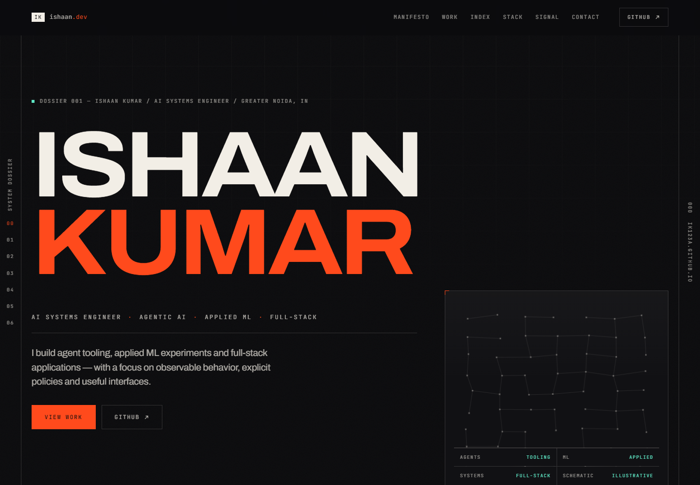
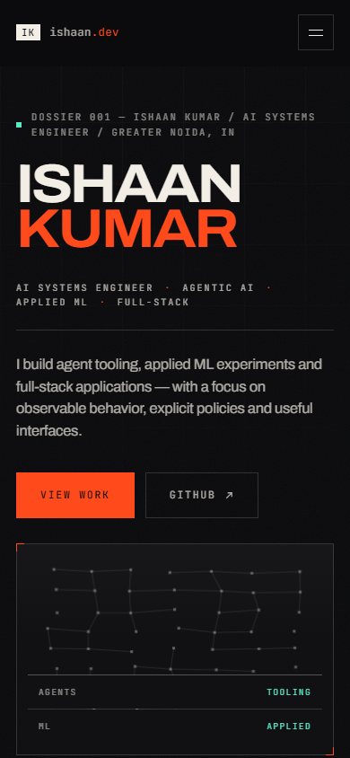
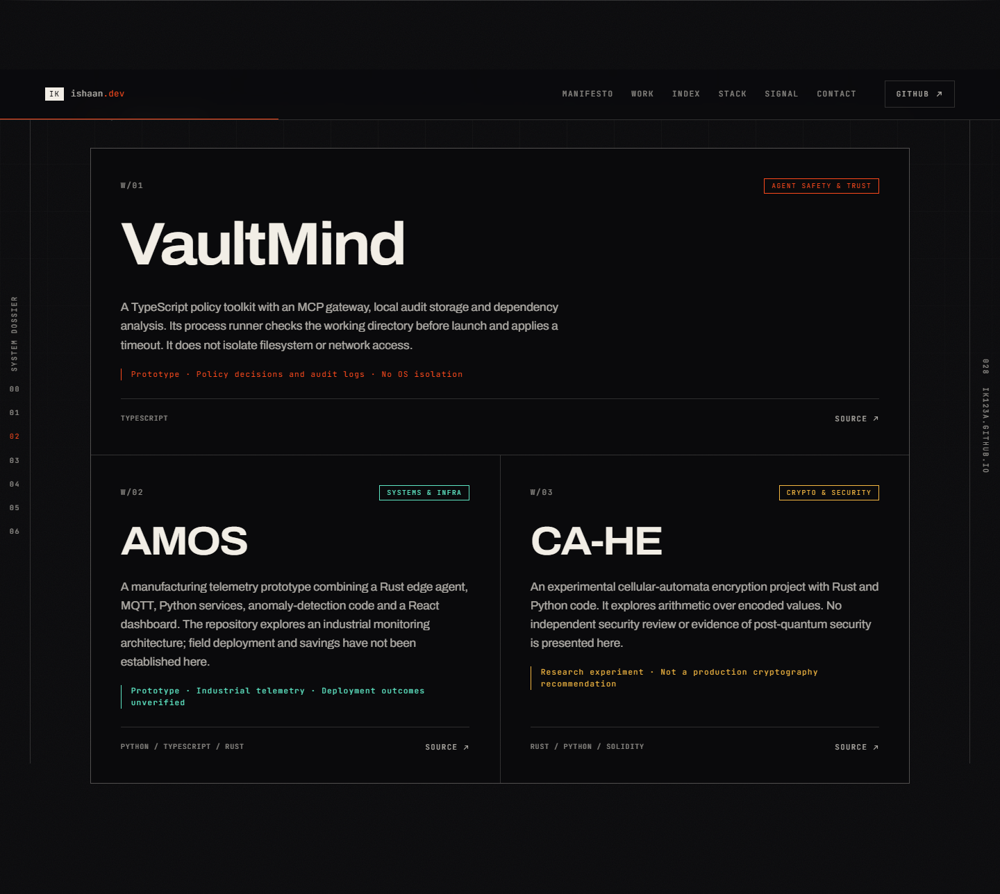

# Ishaan Kumar — System Dossier

Static portfolio for **AI Systems Engineer | Agentic AI | Applied ML | Full-Stack**.
The technical-dossier design uses warm paper typography, a near-black background,
orange annotations and a decorative canvas schematic.

[Live site](https://ik123a.github.io/) · [Public repositories](https://github.com/ik123a?tab=repositories)

## Preview

Actual browser captures of this checkout, served locally in headless Microsoft Edge
on 7 November 2026. Reduced motion was enabled for stable captures. These are site
screenshots, not generated mockups or proof that the featured projects are deployed.



Desktop: identity, professional focus and direct links to the work and source.
[Full-page desktop capture](docs/images/desktop.png).



Mobile: the introduction and work links precede the decorative schematic.
[Full-page mobile capture](docs/images/mobile.png).



Selected work: implementation summaries and explicit prototype/research limits.

## Run locally

No framework, package install or build step is required to serve the site.
From the repository root:

```bash
python -m http.server 8123 --bind 127.0.0.1
```

Open [the local preview](http://127.0.0.1:8123/). Stop it with Ctrl+C.
GitHub Pages can serve the same static files; deployment is managed separately.

## What the site does

- Seven sections: introduction, manifesto, selected work, repository index, stack,
  contribution activity and contact.
- A dated snapshot of 27 public repositories owned by `ik123a`, including learning
  exercises and profile/site repositories. Domain filters update their visible count
  and pressed state. Metadata is curated in HTML, not fetched from GitHub at runtime.
- Responsive navigation with keyboard focus on opening, Escape to close and return
  focus, and automatic closure when switching to desktop width.
- Skip link, visible focus styles, reduced-motion CSS and a canvas loop that stops
  when reduced motion is enabled or the tab is hidden.
- Content remains visible when JavaScript is disabled or `app.js` fails to load.
  No-JavaScript visitors get section links and the complete repository index;
  interactive filters are hidden.

`index.html` contains all content. `styles.css` contains layout and visual tokens.
`app.js` progressively enhances the page. `avatar.png` is the identity monogram.
`tests/smoke.py` exercises the actual local page and can reproduce the captures.

## Verify and capture

The optional browser checks require Python, the Python `playwright` package and an
installed Microsoft Edge browser. They use headless Edge; no browser download,
credentials, model API or project backend is needed. No tools are installed by the script.

```bash
python tests/smoke.py -v
python tests/smoke.py --capture docs/images
```

The script starts a temporary static server bound to `127.0.0.1` and closes it on
completion. Tests block external requests, covering offline fallback rendering,
filter counts, mobile navigation, changed reduced-motion preference, local anchor
links, the identity image and layout at 320, 390, 768 and 1440 pixels. Captures allow
the page's normal external assets and scroll through the actual sections before saving.
Browser support beyond the tested Edge environment and screen-reader behavior are
not established by this smoke suite.

## Data and limits

Repository snapshot: **7 November 2026**. To refresh it, review the public inventory,
update repository links, primary-language labels, domain totals, headline totals and
snapshot dates together, then rerun the browser checks. Private repositories do not
belong in this public index. Stars and language percentages were removed because the
previous values had no verified snapshot date.

Project descriptions summarize source and intent; they do not establish deployment,
financial returns, field savings, clinical use or cryptographic security. In particular,
VaultMind's process runner provides working-directory preflight checks and a timeout,
not OS isolation. Optional LLM judges in agenttest can vary and use external providers.
CA-HE remains an experimental cryptography project without an independent security
assessment presented here. Consult each repository's current documentation and limits.

Google Fonts and the contribution image from `ghchart.rshah.org` are third-party
requests. Font stacks fall back to local fonts; a failed chart gets a decorative
placeholder and an unavailable label. The schematic and placeholder are illustrative,
not live service status or contribution measurements. The page contains external
GitHub, LinkedIn and email links; their availability is outside this repository.
